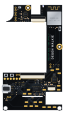

# Degen Walkie

**Talk your book. Then trade it.**

Degen Walkie is a handheld perp trading terminal with a live room for every ticker. Hear traders, pros and an AI talk the market in your language, build the order in a few taps on the touch screen, and press a physical trade key to send it. Perps on Hyperliquid, Pacifica (Solana) and Lighter (Robinhood Chain).

We never hold your money. Your own wallet approves a revocable trading key on each venue; funds stay in your account.

Website: **[degenwalkie.trade](https://degenwalkie.trade/)** · Try the firmware in your browser: **[degenwalkie.trade/sim](https://degenwalkie.trade/sim)**

## What is open in this repository

| Folder | What | License |
| --- | --- | --- |
| [`website/`](website/) | The full source of [degenwalkie.trade](https://degenwalkie.trade/): Next.js site, three.js viewer of the enclosure, the on-device UI rendered in HTML, Stripe pre-order flow. | MIT |
| [`hardware/`](hardware/) | Mainboard schematic, netlist and bill of materials; wheel daughterboard wiring; a render of the board. | CERN-OHL-S v2 |
| [`firmware/`](firmware/) | Device firmware: C and LVGL on the ESP32-S3. UI, venue clients for Hyperliquid, Pacifica and Lighter, on-device signing, board drivers. The same source builds to WebAssembly for the simulator. | MIT |
| [`simulator/`](simulator/) | The browser simulator at [degenwalkie.trade/sim](https://degenwalkie.trade/sim): the firmware running in WebAssembly against mock Hyperliquid, Pacifica, Lighter and relay servers that check signatures like the real ones. | MIT |

The PCB layout (copper, placement, Gerber files) is not published. The board render is an illustration; its copper traces are decorative.

## Why open

The device holds the trading keys you link to it. You should be able to read the code that stores them and signs your orders, and check every net on the board it runs on. That is why the firmware and the schematic are published before you receive a unit, and why the simulator shows every signed request and how the venue checks it.

## Status

- **Hardware:** rev 7 mainboard (4-layer, ESP32-S3) and wheel daughterboard are in fabrication and assembly. Enclosure prototypes are 3D printed.
- **Firmware:** runs end to end in the simulator (rooms, charts, tickets, signing on all three venues, account linking). Not yet run on a device; the board layer is written against the rev 7 schematic and will be fixed during bring-up. See [`firmware/README.md`](firmware/README.md#not-done-yet) for what is not done.
- **Genesis Edition:** 1,000 units, $99, fully refundable pre-orders at [degenwalkie.trade](https://degenwalkie.trade/).

## Contact

Issues and pull requests are welcome. For anything else, use the contact details on the website.
