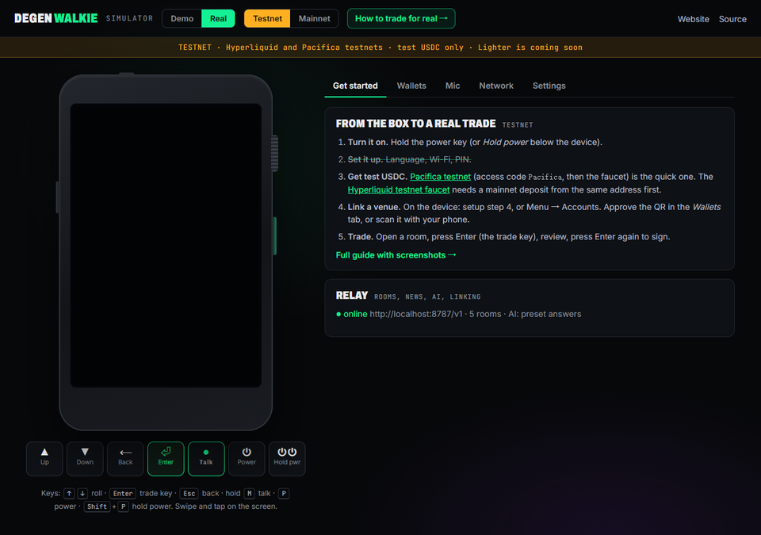
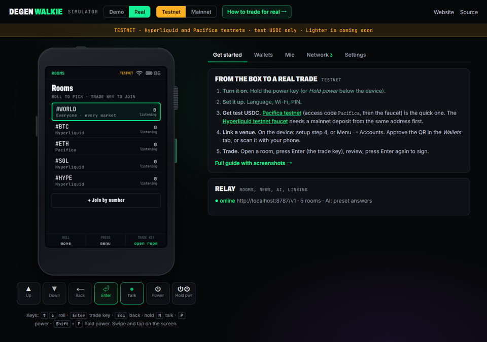
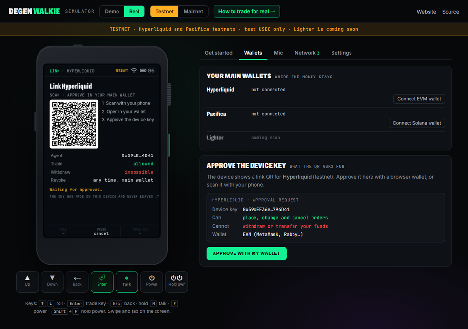
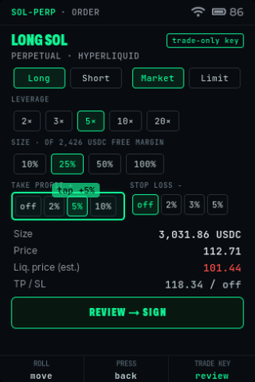
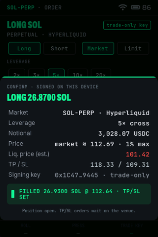
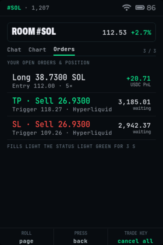
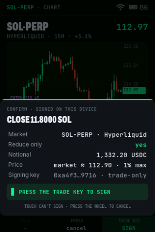
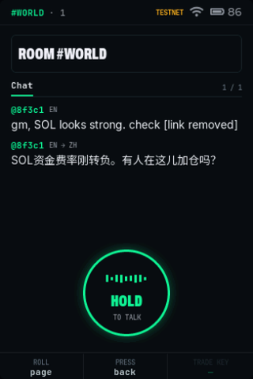

# Trade for real with the simulator

The [simulator](https://degenwalkie.trade/sim) runs the Degen Walkie firmware in your browser. In **Real** mode the device signs real orders on the **Hyperliquid** and **Pacifica testnets** (or mainnet, if you choose). This guide takes you from a device fresh out of the box to an open position with take profit and stop loss.

Budget about 15 minutes. You need a desktop browser (Chrome works best), an EVM wallet extension (MetaMask or Rabby) and/or a Solana wallet extension (Phantom or Backpack).

> **Testnet first.** Testnet USDC has no value. Mainnet is one click away in the simulator, and it is real money: Degen Walkie is in development and unaudited. If you try mainnet, use a fresh account with a small amount.

---

## 1. Get test USDC

You need funds on at least one venue. Pacifica is the quicker one.

### Pacifica testnet (Solana)

1. Open [test-app.pacifica.fi](https://test-app.pacifica.fi) and connect your Solana wallet (Phantom / Backpack).
2. Enter the access code **`Pacifica`**.
3. Use the faucet in the app to mint test USDC, then deposit it into your Pacifica account (the app walks you through it).
4. You should see a balance in the Pacifica testnet app.

### Hyperliquid testnet (EVM)

1. The [Hyperliquid testnet faucet](https://app.hyperliquid-testnet.xyz/drip) gives 1,000 mock USDC, **but only to an address that has deposited on Hyperliquid mainnet before** (at least $5 USDC). If your wallet has used Hyperliquid, you are set.
2. Connect the same EVM wallet at [app.hyperliquid-testnet.xyz/drip](https://app.hyperliquid-testnet.xyz/drip) and claim.
3. You should see 1,000 USDC in your testnet account.

You can do one venue or both. Lighter is shown on the device but locked in Real mode for now; it works in the Demo.

## 2. Open the simulator in Real mode

Go to **[degenwalkie.trade/sim](https://degenwalkie.trade/sim)** and switch the top toggle to **Real**. Leave the network on **Testnet**.

The device is **off**, like a new unit in its box.

**Controls.** You can use the device's own side keys, the buttons under it, or the keyboard:

| Device | Button below | Keyboard |
| --- | --- | --- |
| Roll the thumb wheel | ▲ Up / ▼ Down | ↑ / ↓ (or scroll on the screen) |
| Press the wheel (back) | ⟵ Back | Esc |
| Trade key (open / enter / **sign**) | ⏎ Enter | Enter |
| Hold to talk | ● Talk | hold M |
| Power key, short press (screen off/on) | ⏻ Power | P |
| Power key, held 2 s (power on / power off) | ⏻⏻ Hold pwr | Shift + P |

The screen is a touch screen: tap, scroll lists, swipe left/right between top pages, pull down from the top for quick settings. **Touch can do everything except sign an order.** Only the trade key signs.

## 3. Power on and set up

1. **Hold power** (⏻⏻, or Shift + P). The device boots.
2. **Language.** Roll to the language you want to *hear* the rooms in, press the trade key. Rooms and AI answers will be translated into it.
3. **Wi-Fi.** The simulator is already online. Press the trade key.
4. **PIN.** Six digits: roll the wheel to change the digit and press the trade key for the next one, or tap the keypad. You will enter it every time the device powers on.

The simulated device powers off whenever you reload the page, like a real one when its battery is pulled. Next time: hold power, enter your PIN, and you are back in the rooms. Your keys and settings stay in this browser.

## 4. Link a venue

The device now asks you to link a venue. This is the important part: **the device makes its own trading key, and your main wallet approves it.** Your main wallet's key never touches the device.

1. On the device, roll to **Hyperliquid** or **Pacifica** and press the trade key. A QR code appears.
2. In the simulator's **Wallets** tab, the request appears automatically. It shows exactly what you are approving:
   - **Can:** place, change and cancel orders.
   - **Cannot:** withdraw or transfer your funds.
3. Click **Approve with my wallet**. Your wallet asks for one signature:
   - Hyperliquid (MetaMask/Rabby): an `ApproveAgent` typed-data signature.
   - Pacifica (Phantom/Backpack): a `bind_agent_wallet` message signature.
4. The device shows **Linked**. Do the other venue too if you like, then roll to **Continue**.

**On a phone instead?** Scan the QR with your phone's camera. It opens the same approval page; open it inside your wallet's browser (MetaMask, Phantom) and approve.

**Revoking.** On the device, Menu → Accounts → Revoke access erases the key from the device. To cut it off at the venue as well, revoke the agent from your main wallet in the venue's app. Either way your funds never move.

## 5. Your first trade

1. Press the trade key on **Start**. You land in **Rooms**: the world room plus one room per asset, with live testnet prices.
2. Roll to **#SOL** (Hyperliquid) or **#ETH** (Pacifica) and press the trade key to open the room.
3. Press the trade key again: the **order ticket** opens for that market.
4. Set it up (tap, or roll + trade key):
   - Long / Short, Market / Limit
   - Leverage
   - Size, as a share of your free margin
   - **Take profit** and **stop loss** (optional), as a percentage from your entry
5. Tap **Review → Sign**. The confirmation sheet shows market, size, price, estimated liquidation and TP/SL.
6. **Press the trade key to sign.** The status light blinks blue while the order travels, then turns green when it fills. If you set TP/SL, the device places them right after the fill.

 

Check the venue's own testnet app: the position is there, opened by your device's agent key.

## 6. Manage it

- **Room → Orders tab** (roll twice inside a room) shows your position, resting limit orders and TP/SL triggers. Press the trade key there to cancel open orders.
- **Positions** (swipe left from Rooms) shows every position with PnL and distance to liquidation. Open one for the chart, then **ADD**, **HALF** or **CLOSE**. Closing is reduce-only at market and also needs the trade key.
- **Voice orders**: hold Talk anywhere outside a room and say an order ("long SOL five x fifty USDC"). Type it in the **Mic** tab, or tick *Use my microphone* (your browser asks for permission). It becomes a ticket; the trade key still signs.

 

## 7. Rooms and the AI

- **Rooms are live and shared.** Everyone using the simulator or a device is in the same rooms. Hold **Talk** in a room to post (typed text or your microphone). Each listener reads your message in their own language.
- You don't need a linked venue to talk: without one you show as a guest. Rooms are moderated: links are removed, scams are blocked, and posting is rate-limited per address or device.
- **Ask** (swipe to it) answers questions about your own book: liquidation distance, funding, a summary. The AI is read-only and cannot trade.

## 8. Mainnet (optional, real money)

Switch the network toggle to **Mainnet** and confirm the warning. The simulator then signs on Hyperliquid and Pacifica mainnet with keys it makes for that network (testnet keys are kept separately). Everything else works the same.

- Use a fresh account and an amount you can afford to lose.
- The device key can trade but **cannot withdraw**. Revoke it from your wallet when you are done.
- The simulated device stores its keys in your browser's `localStorage`. Anyone with access to this browser profile can use them to trade (not withdraw). Settings → **Factory reset** erases them.

## Troubleshooting

| Problem | Fix |
| --- | --- |
| Hyperliquid: "Must deposit before performing actions" | The account has no testnet funds yet. Claim from the faucet first (step 1). |
| Pacifica: "Account must have registered … first deposit" | Deposit test USDC into Pacifica testnet first. |
| Hyperliquid faucet refuses | The address needs a past Hyperliquid mainnet deposit. Use Pacifica instead, or a wallet that has used Hyperliquid. |
| The wallet doesn't pop up | Unlock the extension. For Hyperliquid, any chain works: the approval is signed for the chain your wallet is on. |
| "Relay offline" | Rooms, news, the AI and QR linking pause; trading still works. Try again later. |
| "Size is zero" on the ticket | Free margin is zero on that venue. Fund it, or pick a bigger size share. |
| Start over | Settings → Factory reset (this network only), then hold power again. |

## What is real here

- **Real:** the firmware (the same C code that builds for the ESP32-S3), the agent keys it makes, the EIP-712 and Ed25519 signatures, and every order. They go straight from your browser to Hyperliquid and Pacifica. Open the **Network** tab to see each request.
- **Not here:** Lighter (locked in Real mode), and the hardware itself: the simulator stands in for the screen, wheel, keys, light and mic.
